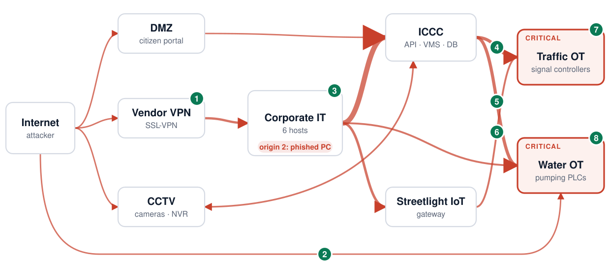
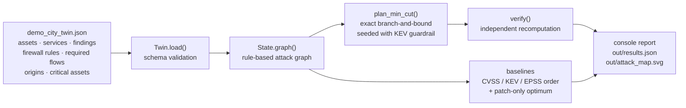

<div align="center">

# CHOKEPOINT

**Find the fewest fixes that cut every attack path to a city's critical services, without breaking the city.**


ChronoForge 2026 · NITK Surathkal · Theme: *Cities of the Future* · **Cybersecurity track** · Team Hercules

</div>

CHOKEPOINT is a defensive planning engine for smart-city networks. It works in four steps:

1. Build a **logical attack graph** from the network's assets, firewall rules, and weaknesses.
2. Compute the **minimum-cost set of fixes** that disconnects every attacker origin from every critical asset.
3. Treat the **service flows the city depends on as hard constraints**, so a fix can never cut them.
4. **Re-verify the plan independently** before reporting it.

This repository is the **Round 1 proof of concept**. It runs offline on a **synthetic** "Demo City" twin and never scans, probes, or exploits any real system.

<p align="center"></p>
<p align="center"><sub>Generated by <code>run_demo.py</code> from the actual analysis. Red arrows: attack edges between zones before any fix (thicker = more edges). Numbered badges: where each of the 8 plan steps cuts the graph.</sub></p>

---

## Contents

[The problem](#the-problem) · [What CHOKEPOINT does differently](#what-chokepoint-does-differently) · [Quick start](#quick-start) · [How it works](#how-it-works) · [The synthetic Demo City](#the-synthetic-demo-city) · [Results](#results) · [Feature status](#feature-status) · [Limitations and responsible use](#limitations-assumptions-and-responsible-use) · [Roadmap](#roadmap-hacking-round) · [References](#references)

## The problem

Every one of India's 100 Smart Cities runs an Integrated Command & Control Centre (ICCC). Each links transport, water supply, and waste systems, and 84,000+ CCTV cameras are installed across the mission [1]. Attacks on this kind of infrastructure are real and often simple:

- From Nov 2023, attackers accessed US water facilities through internet-exposed PLCs with default or no passwords [3].
- Likely intrusions hit at least 7 Indian State Load Despatch Centres, with internet-facing DVR/IP cameras likely co-opted for command-and-control [4].

**Ranking findings by a severity score alone falls short for a city:**

- **Severity ignores reachability.** Only ~6% of published CVEs are ever observed exploited in the wild [5]. What matters is whether a weakness sits on a *path* to a pump or a signal controller.
- **Scores can bury real attack routes.** The Unitronics default-password flaw (CVE-2023-6448) is in CISA KEV, yet its EPSS score on 20 Oct 2026 was **0.021** [8].
- **The obvious fix can break the city.** Deleting a firewall rule may cut a command centre's telemetry to traffic signals. A list of findings can't tell you which fix breaks which service.

## What CHOKEPOINT does differently

| | Severity-ordered patching | CHOKEPOINT |
|---|---|---|
| Unit of analysis | individual findings | **attack paths** from attacker origins to critical assets |
| Output | ranked list | **minimum-cost fix set** that leaves 0 paths |
| Fix types | patch / credential change | patch, credential change, **remove or narrow a firewall rule**, vault stored credentials |
| City services | not modelled | **required flows are hard constraints**; a rule carrying one can only be narrowed, never removed |
| Assurance | none | **independent verifier** recomputes reachability and flows from scratch |

This builds on established attack-graph research (MulVAL [7]) and optimal-hardening research (e.g. CySecTool [9]). The combination this PoC adds is **service-continuity constraints + a KEV guardrail + assume-breach origins + an independent verify step**, applied to a city-services model.

## Quick start

Requires **Python 3.9+** and Git. There are no third-party packages. Tested on Python 3.9.6, 3.11.15, and 3.12.13 (macOS).

```bash
git clone https://github.com/Sidd927/ChronoForge.git
cd ChronoForge/prototype/chokepoint
python3 run_demo.py                          # analysis report, writes out/results.json + out/attack_map.svg
python3 -m unittest discover -s tests -v     # 11 tests, a few seconds
```

<details>
<summary><b>Expected demo output</b> (abridged)</summary>

```text
Twin: Demo City digital twin (SYNTHETIC)  (20 assets, 19 scanner findings, 4 KEV)
BEFORE: 4/4 critical assets reachable from ['internet', 'clerk_pc']; 123,709 attack paths*
  attack paths by hop limit: <=2: 17, <=4: 815, <=6: 11,181, <=8: 57,549, <=10: 123,709

PLAN (8 actions, cost 12.0, 96 states explored):
  1. [remediate] Upgrade FortiOS and reset all VPN credentials on Vendor SSL-VPN gateway (CVE-2018-13379)  (cost 5.0)  [KEV guardrail]
  2. [remove_rule] Remove firewall rule R04 (PLC exposed for vendor remote maintenance)  (cost 0.5)
  3. [remediate] Rotate credentials, enforce NLA + MFA on Utility engineering workstation (SYN-004)  (cost 1.0)
  4. [restrict_rule] Restrict rule R11 (ICCC -> traffic OT) to its 1 required flow(s)  (cost 1.5)
  5. [restrict_rule] Restrict rule R12 (ICCC -> water OT (broad)) to its 1 required flow(s)  (cost 1.5)
  6. [remove_rule] Remove firewall rule R15 (Shared pole fibre: streetlight -> traffic (flat))  (cost 0.5)
  7. [remediate] Rotate default admin credentials on Adaptive traffic control server (SYN-005)  (cost 1.0)
  8. [remediate] Enable VNC authentication on Water SCADA HMI (SYN-008)  (cost 1.0)

VERIFY: critical reachable=[]  attack paths=0  broken required flows=[]  -> PASS

BASELINES (fixing scanner findings in score order until zero attack paths):
  CVSS-ordered patching          16 fixes, cost 69.0
  KEV-first, then CVSS           16 fixes, cost 69.0
  EPSS-ordered patching          19 fixes, cost 87.0
  Optimal, patch/credential only  7 fixes, cost 24.0
  CHOKEPOINT (all action types)   8 fixes, cost 12.0

Rules carrying a required flow (never removed, only restricted): 14 of 18
```
Exit code is `0` only if the plan passes verification. Runtime is about 0.7 s on a laptop.
</details>

**Run on your own twin:** `python3 run_demo.py path/to/twin.json`. The schema follows [`data/demo_city_twin.json`](prototype/chokepoint/data/demo_city_twin.json) and is validated on load. The attack-map figure is drawn only for the Demo City's zone layout; for other twins it is skipped and the report still runs.

**Troubleshooting**
- `python3: command not found`: use `python` (or `py` on Windows) with the same arguments.
- `SyntaxError` or type errors: check `python3 --version` is 3.9 or later.
- Run the commands from `prototype/chokepoint/`. Test discovery and data paths are relative to that folder.

## How it works



All code is in [`prototype/chokepoint/chokepoint/engine.py`](prototype/chokepoint/chokepoint/engine.py), about 400 lines of standard-library Python.

**1. Attack graph** (`State.graph`, MulVAL-inspired rules). An edge `u → v` exists if either of these holds:
- A firewall rule permits `u → v:port` **and** the service on `v:port` has an unremediated weakness.
- A rule permits `u → v:port` **and** `u` stores credentials for `v` (for example, an engineering workstation holding SCADA logins).

Rules match an asset ID or a whole zone.

**2. Action model.** Cost is in weighted hours: engineer effort + 2 × service downtime.

| Action | Effect | Cost |
|---|---|---|
| `remediate` | removes one finding on one asset | per finding: effort + 2 × downtime (from the twin) |
| `remove_rule` | deletes a rule. **Only offered if the rule carries no required flow.** | 0.5 |
| `restrict_rule` | narrows a rule to exactly the required flows it carries | 1.5 |
| `vault_creds` | removes stored-credential edges from a host | 2.0 |

**3. KEV guardrail.** A CISA-KEV finding on a service that *must* stay internet-facing is always remediated, even if the graph could be cut elsewhere.

**4. Planner** (`plan_min_cut`). This is an exact branch-and-bound over the action model. Any feasible plan must break the current shortest attack path, so it must contain an action that neutralises one of that path's edges. The search branches only on those actions and prunes by cost. The result is optimal **with respect to the action model and its cost estimates**. That claim is backed in two ways:
- A brute-force cross-check on a hand-built network.
- A brute-force cross-check on **299 randomly generated attackable networks**, 109 of which need two or more fixes. A deliberately greedy planner fails this test.

The 20-asset Demo City itself is too large to brute-force, so its optimality rests on the algorithm's argument plus these tests.

**5. Verifier** (`verify`). It rebuilds the graph from scratch with the plan applied. It passes only if no critical asset is reachable from any origin **and** every required flow is still permitted.

**6. Baselines.** These are scanner-style remediation: fix findings one at a time in CVSS, KEV-first, or EPSS order until no attack path remains. Scanner baselines cannot change firewall rules, so we also report the **optimal patch/credential-only plan**. That separates the gain from path-awareness from the gain from service-safe segmentation.

## The synthetic Demo City

[`data/demo_city_twin.json`](prototype/chokepoint/data/demo_city_twin.json) is a **fictional** network modelled on typical ICCC components:
- 20 assets in 8 zones: DMZ, Vendor VPN, Corporate IT, ICCC, CCTV, Traffic OT, Water OT, Streetlight IoT.
- 18 firewall rules, 19 findings, and 19 required service flows.

| Critical asset | Civic impact (illustrative) |
|---|---|
| Signal controllers, Corridor A | 18 signalised junctions |
| Signal controllers, Corridor B | 14 signalised junctions |
| Pumping Station 1 PLC (Unitronics) | drinking water, Zone North |
| Pumping Station 2 PLC (Rockwell) | drinking water, Zone South |

**Attacker origins:** the internet, plus a phished municipal clerk PC (assume-breach).

Real CVEs attached to synthetic assets. KEV status is from NVD API 2.0 and EPSS from the FIRST API, both retrieved on 20 Oct 2026 and stored as a snapshot in the twin file:

| CVE | Weakness | CVSS | KEV (date added) | EPSS |
|---|---|---|---|---|
| CVE-2018-13379 | FortiOS SSL-VPN path traversal | 9.1 | yes (2021-11-03) | 0.99999 |
| CVE-2021-36260 | Hikvision web-server command injection | 9.8 | yes (2022-01-10) | 0.99869 |
| CVE-2023-6448 | Unitronics Vision PLC/HMI insecure default password | 9.8 | yes (2023-12-11) | 0.02089 |
| CVE-2021-22681 | Rockwell Logix insufficiently protected credentials | 9.8 | yes (2026-03-05) | 0.63630 |

The 14 `SYN-*` finding types (15 instances) are synthetic but representative misconfigurations: default credentials, unauthenticated VNC, flat networks, and similar. Effort and downtime hours are **assumed estimates**.

## Results

Synthetic twin; reproduce with `python3 run_demo.py`.

| Metric | Value | Definition |
|---|---|---|
| Critical assets reachable before | **4 / 4** | from either origin |
| Attack paths before | **123,709** | simple paths of ≤ 10 edges from an origin to a critical asset, stopping at the first critical asset reached, summed over both origins. Highly sensitive to the hop limit: ≤2: 17 · ≤4: 815 · ≤6: 11,181 · ≤8: 57,549 |
| CHOKEPOINT plan | **8 actions, 12.0 weighted h** | verified: 0 paths remain, **0 of 19** required flows broken |
| Optimal patch/credential-only plan | 7 fixes, 24.0 h | same planner, firewall actions disabled |
| CVSS-ordered patching | 16 fixes, 69.0 h | KEV-first gives the same result on this twin; EPSS order: 19 fixes, 87.0 h |
| Rules carrying a required flow | **14 of 18** | the planner never removes these outright, only narrows them |

**Reading the comparison fairly:**
- Path-awareness alone cuts cost from 69.0 to 24.0 h on this twin (≈ 2.9×).
- Adding service-safe firewall narrowing cuts it to 12.0 h (≈ 5.8× vs CVSS order).
- These numbers depend on the synthetic topology and the assumed cost estimates. They demonstrate the mechanism, not real-world performance.

## Feature status

| Capability | Status |
|---|---|
| Twin schema and validation | ✅ Implemented & tested |
| Rule-based attack-graph construction (exploits + stored credentials, zone/asset rules) | ✅ Implemented & tested |
| Minimum-cost planner with service-continuity constraints | ✅ Implemented & tested (brute-force cross-checked on small networks) |
| KEV guardrail and assume-breach origins | ✅ Implemented & tested |
| Independent verifier | ✅ Implemented & tested |
| Score-ordered baselines + patch-only optimum | ✅ Implemented & tested |
| Zone-level attack-map SVG | ✅ Implemented (visually checked; layout specific to Demo City) |
| Optimality at Demo City scale | ⚠️ Follows from the algorithm; **not** independently brute-forced at this size |
| Realism of the twin and the cost estimates | ⚠️ Synthetic assumptions; not validated against a real city network |
| Live NVD / CISA KEV / FIRST EPSS clients with offline cache | 🔜 Planned. The PoC uses a snapshot stored in the twin JSON |
| Importers for firewall configs / CMDB / scanner exports | 🔜 Planned |
| FastAPI service and React attack-map dashboard | 🔜 Planned |
| LLM agent layer (parse configs, orchestrate tools, explain plans) | 🔜 Planned. Will never make the security decision; the deterministic core does |
| Min-cut / ILP fallback for large estates; Docker packaging | 🔜 Planned |

**Technology actually used:** Python 3.9+ standard library only (`json`, `dataclasses`, `collections`, `unittest`), plus hand-written SVG output.

## Limitations, assumptions and responsible use

- **Synthetic data.** No real city network, municipal data, or partner is involved. Civic-impact labels are illustrative.
- **Model fidelity.** Results are only as good as the inventory, rules, and findings fed in. An unknown asset or a missing rule means a missing path.
- **Threat model.**
  - Covered: network reachability plus known weaknesses (CVE or misconfiguration) plus stored credentials.
  - Not modelled: physical access, supply-chain compromise, zero-days, insider misuse of legitimate flows, and exploit reliability or probability.
- **Scale.** Exact search is shown at city-zone scale. Large estates need the planned min-cut/ILP fallback.
- **Responsible use.** CHOKEPOINT is analysis-only. It contains no scanning or exploit code and makes no changes to any system. Real deployments must use authorized, passively collected inputs. Every change needs human approval and staged rollout. An attack map is sensitive information, so keep it on-prem with access control.

## Roadmap (hacking round)

1. **0–3 h:** importers for configs and inventories; live KEV/EPSS/NVD clients with offline cache.
2. **3–9 h:** FastAPI service around the engine; more scenario origins; regression tests.
3. **9–16 h:** React + Cytoscape.js attack-map dashboard with before/after view and plan cards.
4. **16–20 h:** tool-calling LLM agent for parsing, orchestration, and plain-language briefs, with schema-validated I/O.
5. **20–24 h:** a larger twin, end-to-end tests, and a scripted demo.

## References

1. PIB, "10 Years of Smart Cities Mission", 24 Jun 2025. https://www.pib.gov.in/PressNoteDetails.aspx?NoteId=154736&ModuleId=3
2. PIB (Ministry of Home Affairs), "Assistance to States to Tackle Cyber Incidents", 24 Mar 2026. https://www.pib.gov.in/PressReleasePage.aspx?PRID=2244504
3. CISA et al., AA23-335A, "IRGC-Affiliated Cyber Actors Exploit PLCs in Multiple Sectors…", Dec 2023. https://www.cisa.gov/news-events/cybersecurity-advisories/aa23-335a
4. Recorded Future, "Continued Targeting of Indian Power Grid Assets…" (TAG-38). https://www.recordedfuture.com/research/continued-targeting-of-indian-power-grid-assets
5. Cyentia Institute & FIRST, "A Visual Exploration of Exploitation in the Wild" (EPSS study). https://www.cyentia.com/publication/epss-study/
6. XM Cyber, "Navigating the Paths of Risk: The State of Exposure Management in 2024". https://xmcyber.com/navigating-the-paths-of-risk-the-state-of-exposure-management-in-2024/
7. X. Ou, S. Govindavajhala, A. W. Appel, "MulVAL: A Logic-based Network Security Analyzer", USENIX Security 2005.
8. NVD API 2.0 (https://services.nvd.nist.gov/rest/json/cves/2.0) and FIRST EPSS API (https://api.first.org/data/v1/epss), queried 20 Oct 2026.
9. "Optimal security hardening over a probabilistic attack graph: a case study of an industrial control system using the CySecTool tool", arXiv:2204.11707. https://arxiv.org/abs/2204.11707

## Team

**Team Hercules**, Pune Institute of Computer Technology (PICT), Pune: Siddhant Patil (team lead) and Aayush Aade.
Built for ChronoForge 2026, NITK Surathkal, Cybersecurity track.
